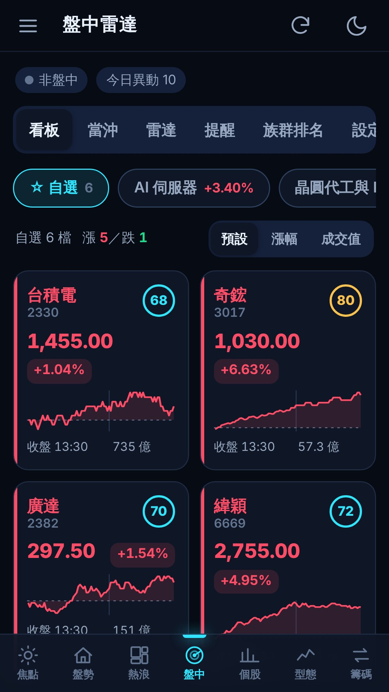

# 商店版 App（Google Play／App Store）

衡析手機版也有商店版 App，Android 與 iPhone／iPad 都可以使用。App 會連回你自己電腦上的衡析，畫面與功能和手機版網頁相同。另外有原生推播、存圖、螢幕恆亮，以及不需要電腦的示意模式。

網頁版（加入主畫面的 PWA）照常可用。兩者可以並用，資料都在同一台電腦。

## 和網頁版的差別

| 項目 | 網頁版（加入主畫面） | 商店版 App |
|---|---|---|
| 安裝 | 用瀏覽器開網址後加入主畫面 | 從 Google Play／App Store 安裝 |
| 推播 | Web Push；iPhone 需 iOS 16.4 以上並從主畫面開啟 | 原生推播（Firebase），iPhone 不必加入主畫面 |
| 圖卡存檔 | 下載或長按圖片 | Android 直接存到相簿（Pictures/EquiLens）；iPhone 開分享選單，可選「儲存影像」 |
| 螢幕恆亮 | 依瀏覽器支援 | 一律支援 |
| 沒有電腦時 | 無法使用 | 可用示意模式瀏覽所有畫面 |
| 功能更新 | 電腦更新後自動更新 | 同左。畫面來自電腦，大部分新功能不必更新 App |

## 怎麼用

1. 先在電腦安裝衡析 Nexus 與手機版，並在「資料與設定 → 遠端存取」設定網域與手機密碼（見 [EquiLens-Pocket/README.md](../../EquiLens-Pocket/README.md)）。
2. 打開 App，在連線頁輸入手機版網址（例如 `https://pocket.example.com`），按「連線」。
   - App 會先確認這個網址是衡析手機版，再用電腦上設定的密碼登入。
3. 到「盤中 → 雷達」按「開啟通知」，允許通知後即可收到推播。可按「發送測試」確認。

| 操作 | 位置 |
|---|---|
| 切換伺服器或回到示意模式 | 左上角 ☰ 設定 →「📱 衡析 App」→「切換伺服器／示意模式」 |
| 連不上電腦時 | App 自動回到連線頁並顯示原因，最近用過的網址列在下方 |
| 點通知 | 開啟對應的分頁；新聞通知用瀏覽器開啟原文 |

連線頁、示意模式與 App 內的文字會依手機語言顯示繁體中文或英文。



## 示意模式

- 連線頁按「使用示意模式」：以 App 內建的合成示意資料展示所有畫面，給還沒安裝衡析的人試用，也給商店審查人員使用。
  - 涵蓋的畫面：焦點、盤勢、熱浪、盤中、個股、型態與籌碼。
  - 上方會顯示「示意模式」提示列，按「連線到我的衡析」回到連線頁。
- 查詢與設定都無法使用；按了會顯示「示意模式無法變更設定或查詢新資料」。
- 時光機不提供。5 分 K、主力分點與大戶持股只有自選股有示意資料。
- 焦點頁的新聞與本周大事紀也是示意內容，新聞標題標示「【示意】」。
- 示意模式不連線、不傳送任何資料。

## 推播的運作方式

```
你的電腦（衡析 Pocket）→ 推播中繼（App 發行者的 Cloudflare Worker）→ Firebase → 手機
```

- 開啟通知時，App 取得 Firebase 推播 token，連同 App 內建的推播中繼網址一起登記到你電腦上的衡析（最多 10 台裝置）。
- 通知的項目與彙整規則和網頁版相同（見[手機版與推播通知](mobile.md#推播通知)）。
- 推播中繼不保存通知內容或 token；token 失效時，電腦上的衡析會自動刪除那台裝置。
- 關閉通知：在「盤中 → 雷達」按「關閉通知」，或在手機設定關閉衡析的通知。

## 隱私

- App 不收集個人資料，沒有廣告、分析或追蹤。
- 網址與登入狀態只存在手機與你的電腦。
- 完整說明見[隱私權政策](../PRIVACY.zh-TW.md)（[English](../PRIVACY.md)）。

## 注意事項

- **電腦必須開機、衡析正在執行**，App 才能顯示資料與收到推播（與網頁版相同）。
- **只接受 https 網址**；Cloudflare 臨時網址會變動，建議使用固定網域。
- **iPhone 首次開啟通知**：App 剛向 Apple 註冊，推播 token 可能要數秒才取得；失敗時稍後再按一次。

## 相關檔案

- App 原始碼與上架流程：[EquiLens-App/README.md](../../EquiLens-App/README.md)
  - Android：`EquiLens-App/android/`
  - iOS：`EquiLens-App/ios/`
  - 推播中繼：`EquiLens-App/relay/`
  - 商店文字與素材：`EquiLens-App/store/`
- 網頁端：
  - `EquiLens-Pocket/public/native.js`（與 App 溝通）
  - `public/live.js`（推播改走 App）
  - `public/app.js`（App 設定卡、示意模式提示、螢幕恆亮）
  - `public/save-image.js`（圖卡交給 App）
- 伺服器：
  - `EquiLens-Pocket/lib/push.mjs`（App 裝置登記、經推播中繼發送）
  - API：`POST /m/api/push/app-subscribe`、`POST /m/api/push/app-unsubscribe`、`GET /m/api/push/key?token=`
